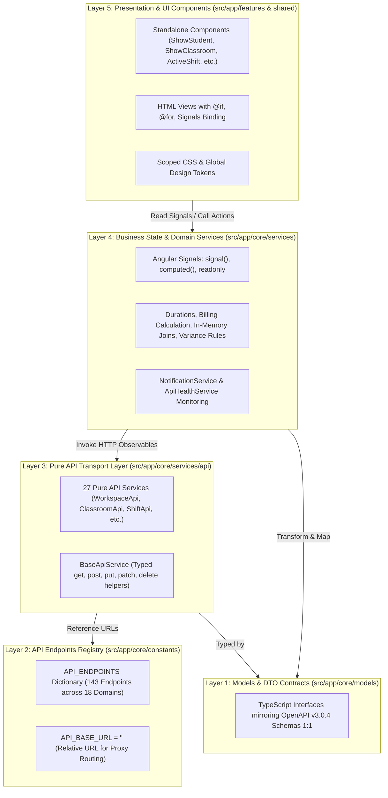
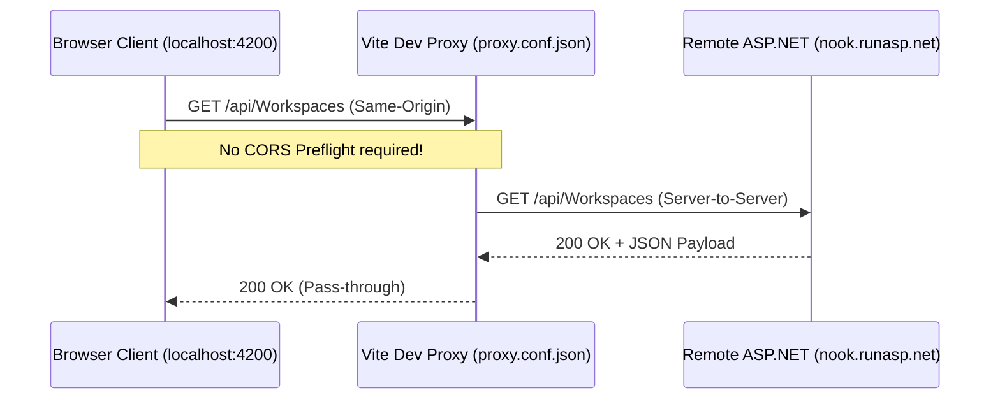

# NOOK Workspace — Technical Audit & Reverse Engineering Report
## Volume 2: Architecture Deep Dive

> **Workspace Path:** `c:\Users\fares\Documents\GitHub\Nook\Frontend`  
> **Architecture Paradigm:** 5-Layer Clean Architecture with Native Angular Signals  
> **Status:** Fully Analyzed & Verified  

---

### 1. The 5-Layer Clean Architecture Model

The application strictly implements a 5-layer separation of concerns designed to ensure maintainability, testability, and decoupling from backend transport details:



#### Detailed Layer Responsibilities

1. **Layer 1: Models & DTOs (`src/app/core/models/`):**
   - Pure contract declarations. Contains **zero logic** or side-effects.
   - Every interface strictly corresponds to the OpenAPI v3.0.4 specification from ASP.NET Core (`https://nook.runasp.net`).
   - Handles nullable fields and GUID string mappings.
2. **Layer 2: API Endpoints Registry (`src/app/core/constants/api-endpoints.ts`):**
   - Centralized dictionary organizing all endpoints by functional domain: `AUTH`, `ACCOUNTS`, `WORKSPACES`, `CLASSROOMS`, `BOOKINGS`, `PACKAGES`, `WORKSPACE_PACKAGES`, `CLASSROOM_PACKAGES`, `DISCOUNTS`, `COUPONS`, `SHIFTS`, `PRODUCTS`, `FACULTIES`, `BLACK_LISTS`, `SETTINGS`, `ANALYSIS`.
   - Parameterized endpoint builders: e.g. `BY_ID: (id: string) => '/api/Workspaces/' + id`.
   - Declares `export const API_BASE_URL = '';` to route requests through proxy layers.
3. **Layer 3: Pure API Services (`src/app/core/services/api/`):**
   - Extend or inject `BaseApiService`.
   - Perform raw HTTP calls returning cold RxJS Observables (`Observable<T>`).
   - Perform no caching, state mutation, or UI side-effects. If an endpoint errors, it surfaces the error to Layer 4.
4. **Layer 4: Business State Services (`src/app/core/services/`):**
   - The "brain" of the application.
   - Implemented as Angular `@Injectable({ providedIn: 'root' })` singletons.
   - Maintain pure in-memory reactive state using native Angular Signals (`signal<T>()`, `computed()`, `.asReadonly()`).
   - Execute domain business logic: calculating billable hours, overtime penalties, applying coupon rules, float balancing.
   - Compensate for backend data gaps by building O(1) in-memory lookup maps (`Map<string, T>`) for fast entity joins.
5. **Layer 5: Presentation Components (`src/app/features/`, `src/app/shared/`, `src/app/layouts/`):**
   - Standalone Angular components (`imports: [...]`).
   - Consume Layer 4 signals directly in templates (`@if`, `@for`, `{{ signal() }}`).
   - Form handling via reactive forms or `[(ngModel)]`.
   - Never inject `HttpClient` or Layer 3 API services directly.

---

### 2. State Management & Reactivity Architecture

#### Pure In-Memory Reactivity Model
Earlier iterations of the project (August 2026) relied on `localStorage` to mock databases. The current codebase has completely eliminated this anti-pattern:
- **Zero Local Database:** All application data is fetched from the backend API upon user login and held in reactive in-memory signals.
- **Selective LocalStorage:** Only three essential session primitives are persisted in browser storage:
  1. `nook_access_token` (JWT Access Token string)
  2. `nook_refresh_token` (JWT Refresh Token string)
  3. `nook_user_data` (Serialized `AuthUser` profile)
- **Garbage Key Cleanup:** Upon bootstrapping in `App` constructor (`src/app/app.ts:14-33`), the application automatically cleanses `localStorage` of any outdated or foreign `nook_*` keys to prevent state corruption.

#### Cross-Service Coordination & Circular Dependency Prevention
Several services require cross-domain state (e.g. `NotificationService` needs to evaluate active sessions from `WorkspaceService`, `ClassroomService`, and `CateringService`).
To prevent circular dependency locks during Angular dependency injection, services utilize **lazy injection via `Injector`**:
```typescript
// Pattern used in NotificationService and WorkspaceService
export class NotificationService {
  private injector = inject(Injector);

  private get workspaceService(): WorkspaceService | null {
    try { return this.injector.get(WorkspaceService, null); } catch { return null; }
  }
}
```
This pattern allows each service to initialize cleanly while maintaining real-time access to adjacent domain state.

---

### 3. Network, HTTP Interceptors & Proxy Architecture

#### Reverse Proxy Topology (CORS Prevention)
A major architectural feature is the elimination of cross-origin preflight requests (CORS `OPTIONS`):



- **Local Development:** `proxy.conf.json` intercepts all `/api`, `/uploads`, and `/Uploads` calls and proxies them over HTTPS to `https://nook.runasp.net` with `changeOrigin: true`.
- **Production (Vercel):** `vercel.json` provides serverless rewrites mapping `/api/:match*` directly to `https://nook.runasp.net/api/:match*`.
- **Result:** The browser always perceives the API as same-origin, completely circumventing browser CORS blocking.

#### HTTP Interceptor & Token Refresh Pipeline (`auth.interceptor.ts`)
The functional interceptor handles three critical tasks:
1. **Bearer Token Injection:** Automatically attaches `Authorization: Bearer <token>` to all outbound requests, excluding whitelisted public endpoints (`/api/Auth/login`, `/api/Auth/register`, `/api/Auth/forgot-password`, `/api/Auth/refresh-token`).
2. **Health Heartbeat Monitoring:** Reports every HTTP completion or network error to `ApiHealthService`.
3. **Concurrent Silent Token Refresh:** If a request receives an HTTP 401 Unauthorized:
   - It checks if a refresh is already in-flight via `isRefreshing` boolean flag.
   - If not in-flight, it marks `isRefreshing = true` and dispatches `POST /api/Auth/refresh-token` with `{ accessToken, refreshToken }`.
   - If already in-flight, subsequent 401 requests pause on a `BehaviorSubject<string | null>`, waiting for the new access token to emit before retrying.
   - If refresh fails, tokens are purged and the user is redirected to `/auth/login`.

---

### 4. Security & Role-Based Access Control (RBAC)

#### Identity & Token Model
- Backend issues standard JSON Web Tokens (JWT) signed with HMAC-SHA256 (`HS256`).
- Verified claims:
  - `http://schemas.xmlsoap.org/ws/2005/05/identity/claims/nameidentifier` -> Account GUID (`52b01827-9faf-491a-90b0-b7b9b037ba4e`)
  - `http://schemas.microsoft.com/ws/2008/06/identity/claims/role` -> User Role (`Admin`, `Staff`, `Cashier`)
  - `exp` -> Token expiration Unix timestamp.

#### Guard Structure
- `authGuard`: Protects the entire dashboard boundary under `''` layout in `app.routes.ts`. Verifies token validity using client-side JWT expiration check (`AuthService.isJwtExpired()`).
- `adminGuard`: Protects privileged administrative routes (`/settings/general` and `/settings/show-user`). Verifies that the current user's role matches `admin`, `superadmin`, or `owner`.

---

### 5. Real-Time Live Operational Alerts Engine

`NotificationService` operates a background evaluation loop:
1. **25-Second Periodic Heartbeat:** Periodically scans the active domain state across all loaded services.
2. **Catering Stock Evaluation:** Detects products whose `stockQuantity` is below warning thresholds (warning: <= 5, critical: 0).
3. **Session Duration Warnings:** Detects student sessions exceeding 4 hours (long stay) or nearing reserved end times.
4. **Classroom Overtime Monitoring:** Flags active room bookings whose current time exceeds scheduled `timeTo`, alerting cashiers to apply overtime rates.
5. **UI Notification Bus:** Dispatches desktop-style slide-out toasts and updates the persistent unread counter badge in `NavbarComponent`.

---

### 6. Internationalization & Theming Architecture

- **`LanguageService` (4,275 lines):** Implements an inline dictionary supporting English and Arabic. When the user toggles the language button, the service:
  - Updates its reactive signal `currentLang`.
  - Sets the root HTML attribute `dir="rtl"` or `dir="ltr"`.
  - Swaps typography classes between English sans-serif (`Poppins`) and Arabic cursive (`Cairo`).
- **`ThemeService`:** Controls dark/light mode by toggling the `data-theme` attribute on `document.documentElement` (`dark` vs `light`), dynamically updating all CSS variables defined in `styles.css`.
