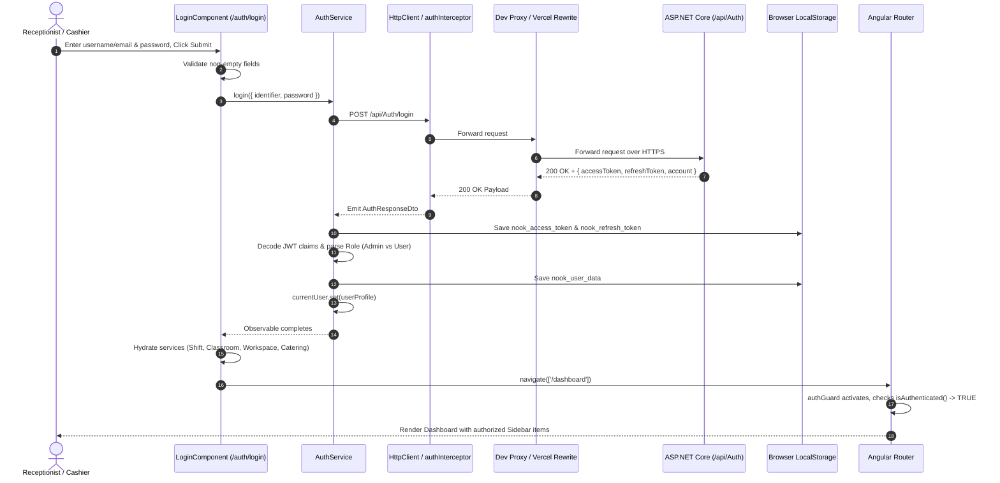
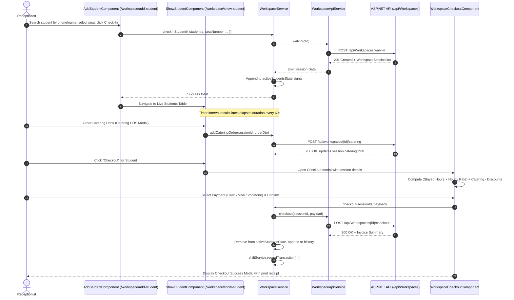
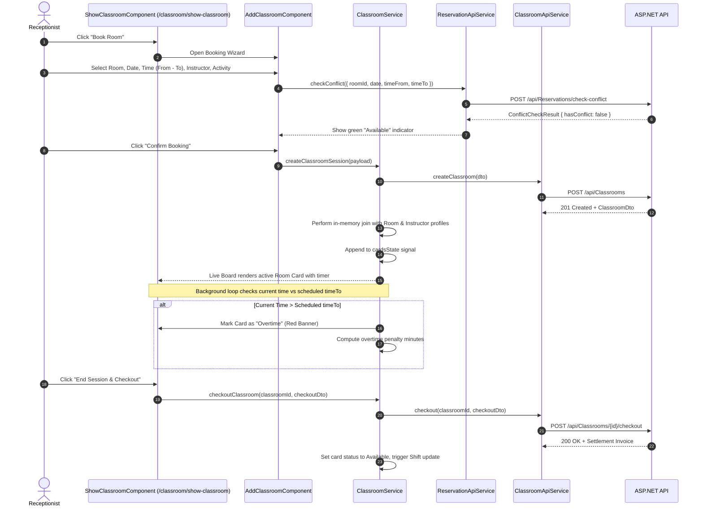
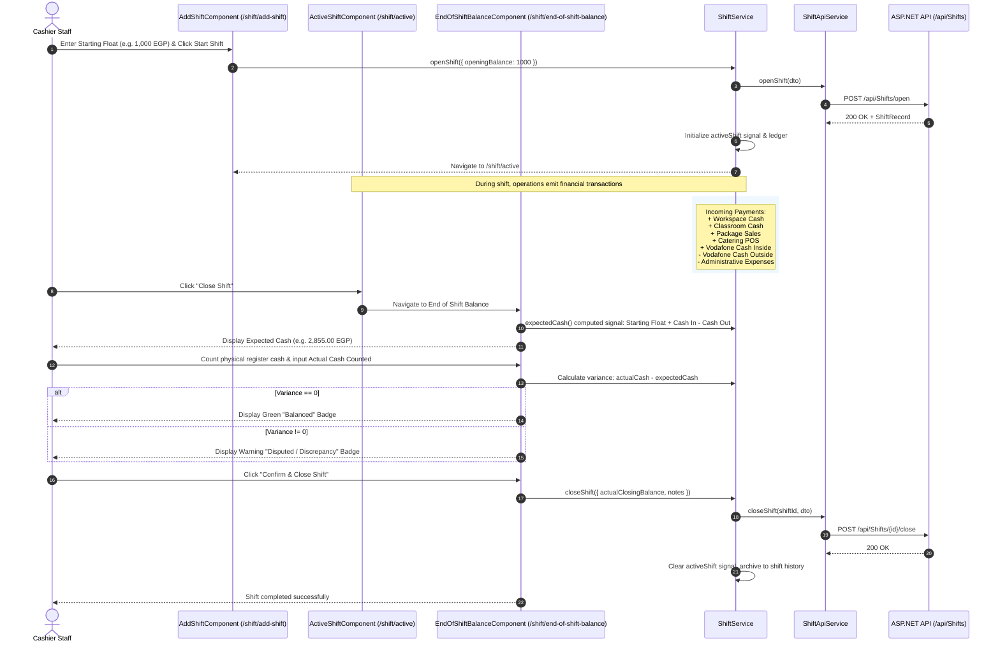
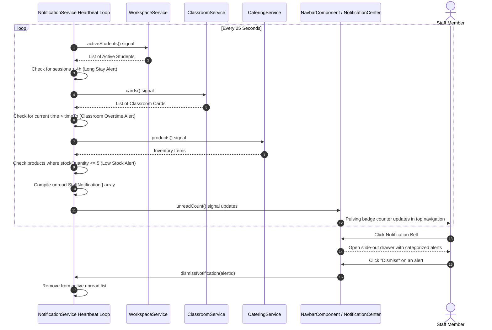

# NOOK Workspace — Technical Audit & Reverse Engineering Report
## Volume 4: Critical End-to-End Data Flows & Tracing

> **Workspace Path:** `c:\Users\fares\Documents\GitHub\Nook\Frontend`  
> **Target API Host:** `https://nook.runasp.net`  
> **Status:** Traced & Verified  

---

### Workflow 1: Authentication, Token Refresh & Role RBAC

#### Detailed Flow Trace
1. **Trigger:** User submits the credentials form on `/auth/login`.
2. **Component Execution (`login.component.ts:182-224`):** Clears previous error messages, checks input presence, and calls `authService.login()`.
3. **HTTP Transport:** `POST /api/Auth/login` is recognized as a public endpoint by `auth.interceptor.ts:10-17`, so no `Authorization` header is attached.
4. **Proxy & Backend:** Vite proxy forwards the request to `https://nook.runasp.net/api/Auth/login`. Backend authenticates against ASP.NET Identity and returns signed JWT tokens.
5. **State & Storage Updates (`auth.service.ts:156-178`):**
   - Access token stored in memory and `localStorage['nook_access_token']`.
   - Refresh token stored in `localStorage['nook_refresh_token']`.
   - User profile signal `currentUser` updated.
6. **Hydration Pipeline (`login.component.ts:198-207`):** Once login resolves, the component asynchronously dispatches hydration calls to:
   - `shiftService.fetchCurrentShiftFromApi()`
   - `classroomService.syncWithBackend()`
   - `workspaceService.loadFromBackend()`
   - `cateringService.syncWithBackend()`
   - `packageService.syncPackagesFromBackend()`
7. **Route Transition:** Navigates to `/dashboard`. `authGuard` verifies `isAuthenticated()` is true and permits activation.

---

### Workflow 2: Student Check-In to Checkout & Invoicing

#### Key Logic & Business Rules
- **Duration Calculation (`workspace.service.ts:176-195`):** Calculates exact time spent from check-in ISO time to current time or checkout time, formatted into standard format (`Xh Ym`).
- **Billing Rate Matrix:** If a student has an active package, the billable study hours are decremented from the package balance. If no active package exists, the student is billed at the hourly rate (defaulting to the faculty/workspace pricing tier).
- **Catering Integration:** Catering items added during the stay are attached directly to the session ID and rolled into the final checkout invoice.

---

### Workflow 3: Classroom Booking, Overtime Tracking & Instructor Settlement

#### Key Logic & Business Rules
- **Conflict Prevention:** Conflict checking calls `POST /api/Reservations/check-conflict` before allowing session creation.
- **Relational Joins on Client:** `ClassroomService` merges the raw `ClassroomDto` with local cached arrays of `RoomDto` and `InstructorDto` to supply `roomName`, `hourlyRate`, and `instructorPhoneNumber` in the UI.
- **Overtime Calculation (`classroom.service.ts:9-11`):** Overtime minutes are computed automatically once current clock time passes the reservation's end time.

---

### Workflow 4: Shift Lifecycle & Cash Drawer Float Reconciliation

---

### Workflow 5: Real-Time Operational Live Alerts Engine

