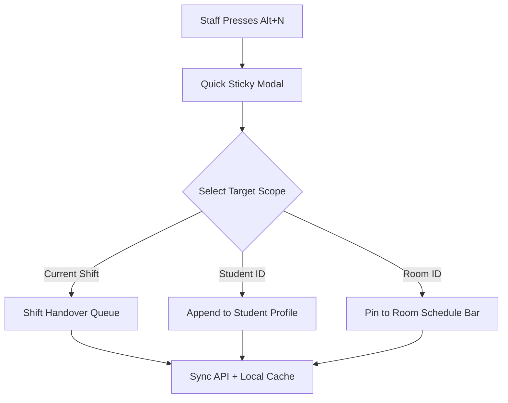

# Architectural Specification: NOOK-FEAT-08 Operational Notes & Sticky Reminders

## 1. Context & Business Need
In a high-paced coworking space like NOOK, receptionists, shift managers, and baristas need instant contextual coordination without interrupting their active POS workflows:
- **Shift Handover Sticky Notes:** "Client in Room 2 requested 5 extra chairs for 5 PM; please invoice company XYZ directly."
- **Student Profile Behavioral Flags:** VIP member tags, specific beverage preferences, warning flags (noise complaints, pending deposit).
- **Scheduled Time-Triggered Reminders:** "Check out Hall 1 projector at 19:30 before lecture ends."
- **Pinned Room Operational Notices:** "AC unit in Silent Zone 1 undergoing filter change until 14:00."

---

## 2. Technical Architecture & Data Models

### 2.1 Entity Model

```typescript
export type NoteScope = 'workspace_general' | 'student_profile' | 'room_board' | 'shift_handover';
export type NotePriority = 'low' | 'normal' | 'high' | 'urgent';

export interface OperationalNoteDto {
  id: string;
  scope: NoteScope;
  targetId?: string;               // studentId, roomId, or shiftId
  content: string;                 // Plain text or markdown
  priority: NotePriority;
  isPinned: boolean;
  isCompleted: boolean;
  reminderAt?: string | null;      // ISO datetime trigger
  createdByStaffId: string;
  createdByStaffName: string;
  assignedToStaffId?: string | null;
  createdAt: string;
  expiresAt?: string | null;
}
```

### 2.2 Shift Handover Lifecycle & Board
- **Active Sticky Board:** Displayed in the Dashboard and Workspace Header with badge counter.
- **Auto-Archive Invariant:** When a shift ends (`POST /api/Shifts/end`), notes scoped to `shift_handover` are summarized and transferred into the shift summary report, preventing cross-shift clutter while preserving audit history.

---

## 3. UI/UX Interaction Design (Design Tokens Compliant)
- **Visual Identity:** Warm cream backdrop (`#f2ede2`), dark cards (`#17181c`), gold accents (`#f5b921`).
- **Urgent Note Toast & Audio Chime:** When `reminderAt` triggers, a subtle slide-down banner appears with high contrast gold borders, accompanied by an optional audio pulse.
- **Quick-Add Flyout:** Accessible via floating button or keyboard shortcut (`Alt + N` / `⌥ + N`).



---

## 4. REST API Contract & Storage Strategy

### 4.1 Backend Endpoints
- `GET /api/Notes?scope={scope}&targetId={targetId}`: Fetch notes filtered by scope.
- `POST /api/Notes`: Create new note with priority and optional reminder date.
- `PATCH /api/Notes/{id}/complete`: Mark note as resolved.
- `DELETE /api/Notes/{id}`: Delete note.

### 4.2 Local Persistence & Offline Fallback
- Local notes cache: `localStorage.getItem('nook_offline_notes')`.
- Web Workers or RxJS `timer()` intervals check for impending reminders every 30 seconds, firing browser notifications (`Notification.requestPermission()`) if tab is backgrounded.
