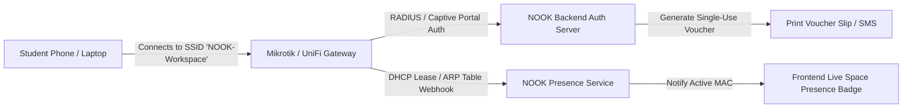

# Architectural Specification: NOOK-FEAT-10 Bulk WhatsApp Engine & WiFi Presence Detection

## 1. Executive Summary
This specification defines two critical automation capabilities for NOOK Workspace:
1. **Bulk WhatsApp Marketing & Notification Engine:** Targeted broadcast messaging (package expiry reminders, lecture announcements, upcoming reservation reminders) directly via the official Meta WhatsApp Cloud API or local WhatsApp Business gateway.
2. **WiFi Presence Detection & Auto-Check-in Telemetry:** Seamless integration with on-premise networking hardware (Mikrotik RouterOS / UniFi Controller) to track student arrival and departure based on device MAC addresses and captive portal voucher authentication.

---

## 2. Component 1: Bulk WhatsApp Messaging Engine

### 2.1 Supported Message Types & Rate Limits
- **Transactional Messages:** (No opt-in needed): Check-in receipt, invoice PDF link, package low-hours alert, booking confirmation.
- **Marketing Broadcasts:** (Requires consent flag): Workshop announcements, exam cram discounts, semester kick-off offers.
- **Rate Limit & Anti-Ban Throttling:**
  - Jittered queue dispatcher: 1 message every 3 to 7 randomized seconds.
  - Maximum 50 messages per batch per worker to adhere to Meta Tier 1 tier limits.

### 2.2 Template Schema & Localization

```typescript
export interface WhatsAppBroadcastBatchDto {
  campaignName: string;
  templateId: string;
  targetAudience: {
    facultyFilter?: string[];
    packageFilter?: string[];
    minVisits?: number;
    inactiveDays?: number;
  };
  variablePlaceholders: {
    studentPhone: string;
    studentName: string;
    dynamicParam1?: string;
    dynamicParam2?: string;
  }[];
  scheduledAt?: string;
}
```

### 2.3 Webhook Event Processing
- Listens to `POST /api/webhooks/whatsapp` for delivery receipts (`sent`, `delivered`, `read`, `failed`).
- Updates message status in real-time on the NOOK Staff Broadcast Console.

---

## 3. Component 2: WiFi Hardware Integration & Captive Portal Sync

### 3.1 Network Architecture (Mikrotik & UniFi)



### 3.2 Automated Presence Tracking Workflow
1. When a student registers or checks in, staff issues a WiFi voucher code or pairs their phone MAC address.
2. The Mikrotik router pushes a periodic ARP/DHCP lease table webhook to `POST /api/telemetry/wifi-presence` every 60 seconds.
3. If an active student's device is absent from the ARP table for >45 minutes during operational hours, a "Potential Left Without Checkout" gentle alert is highlighted on the receptionist's dashboard.
4. Auto-Checkout Suggestion prevents runaway session costs when a student forgets to checkout at the front desk.

---

## 4. Security & Privacy Safeguards
- **GDPR & Egypt Data Privacy Law Compliance:** MAC addresses are hashed using SHA-256 with a salt before long-term storage in audit logs.
- **WhatsApp Opt-Out:** Every broadcast message appends an automatic reply handler ("Reply STOP to opt out of marketing").
- **Isolated Network Segments:** Guest WiFi is VLAN-segregated (VLAN 20) from Point of Sale and management terminals (VLAN 10).
